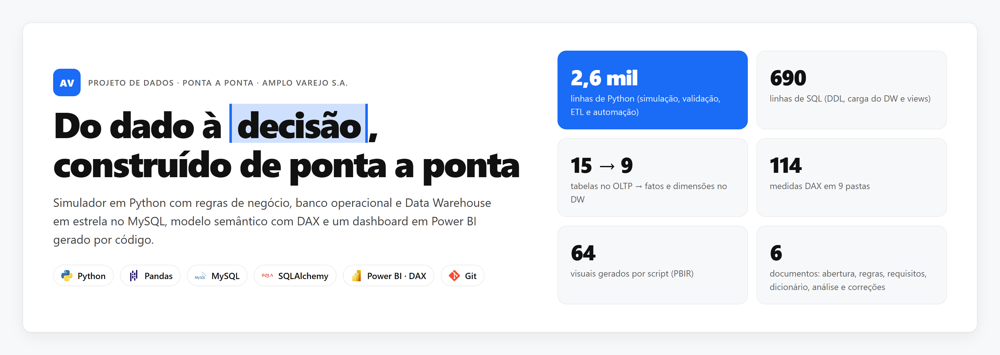
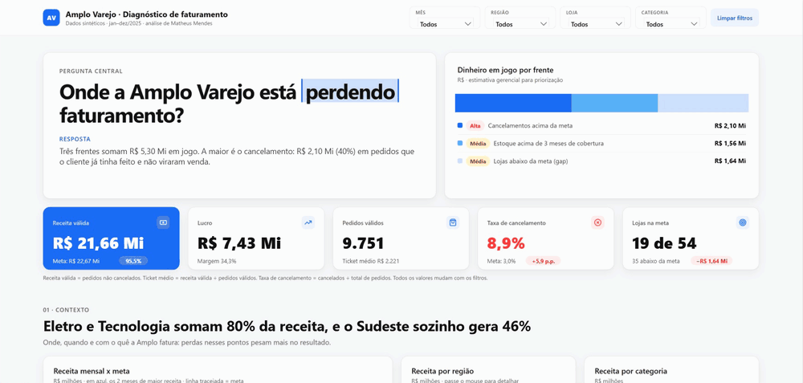
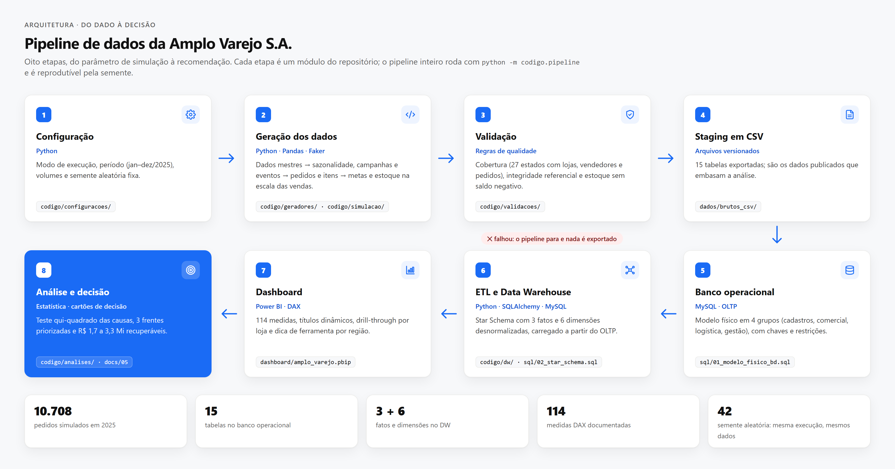
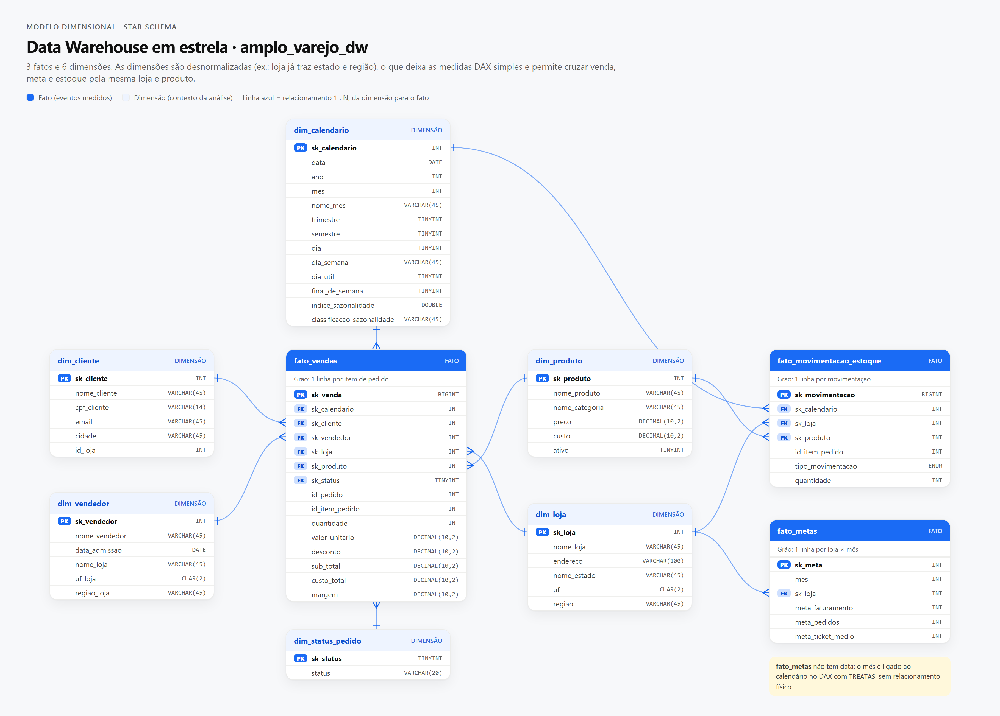
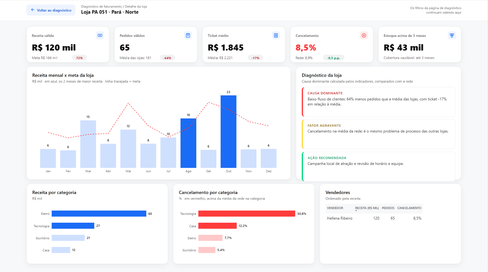

<!-- Banner: adicionar assets/banner.png (modelo do kit-projetos-dados) e descomentar a linha abaixo -->
<!--  -->

# Amplo Varejo S.A. · Onde a empresa perde faturamento

> Simulei a operação de uma rede varejista nacional, do banco de dados ao dashboard, para responder onde a empresa perde faturamento, quanto isso vale e por onde começar a recuperar.


**[📊 Dashboard em uso (GIF)](dashboard/prints/demo_dashboard.gif)** · **[🖼️ Página completa](dashboard/prints/00_diagnostico_completo.png)** · **[📄 Portfólio](https://portfolio-phi-lilac-19.vercel.app/)** · **[📁 Documentação](docs/)**

---

## Em 30 segundos

| | |
|---|---|
| **Problema** | A diretoria não sabe onde a operação deixa faturamento na mesa: pedidos cancelados, lojas abaixo da meta e capital parado em estoque. |
| **Pergunta** | Onde a Amplo Varejo está perdendo faturamento em 2025, quanto isso vale e por onde começar a recuperar? |
| **O que fiz** | Gerei os dados com regras de negócio em Python, modelei um banco operacional e um Data Warehouse em MySQL, construí o dashboard em Power BI e testei as causas com estatística. |
| **Resultado** | 3 frentes de perda com **R$ 1,7 a 3,3 Mi recuperáveis**. A maior é o cancelamento (8,9% contra meta de 3%, R$ 2,10 Mi), que é igual em todas as regiões e lojas: o problema está no processo do pedido. |



<sub>Gravado no Power BI Desktop: filtro por região (números e títulos se recalculam), dica de ferramenta da região e drill-through até o detalhe de uma loja. [Ver a página inteira](dashboard/prints/00_diagnostico_completo.png): contexto, cancelamentos, estoque, lojas, cartões de decisão e plano de ação.</sub>

---

## 1. Pergunta

**Contexto:** a Amplo Varejo S.A. é uma rede varejista **fictícia** com 54 lojas nos 27 estados. Todos os dados são sintéticos, gerados por um simulador com regras de negócio reais (sazonalidade, campanhas, eventos, metas e estoque).

**Problema de negócio:** a empresa fechou 2025 a 95,5% da meta, com quase 1 em cada 11 pedidos cancelado e estoque acima do necessário, sem saber qual dessas perdas atacar primeiro.

**Pergunta central:**
> *"Onde a Amplo Varejo está perdendo faturamento em 2025, quanto isso vale e por onde começar a recuperar?"*

**Perguntas de apoio:**
- O cancelamento está concentrado em alguma região, loja, mês ou categoria?
- Quantas lojas ficaram abaixo da meta e quanto do gap elas concentram?
- Quanto capital está parado em estoque acima da cobertura saudável, e em quais produtos?

📄 [Documento de abertura](docs/01_abertura.md)

## 2. Dados

| Fonte | Tipo | Volume | Período | Licença |
|---|---|---|---|---|
| Simulador próprio (Python + Faker) | Sintético | 10.708 pedidos · 21.339 itens · 7.500 clientes · 54 lojas · 100 vendedores · 80 produtos | 2025 | Dados fictícios, sem restrição de uso |

**Qualidade:** antes da exportação, validações automáticas conferem cobertura (27 estados com lojas, vendedores e pedidos), integridade referencial e estoque sem saldo negativo. Na revisão de outubro de 2026 corrigi a escala de metas e estoque, a semente do simulador e cinco medidas DAX. Ver o [registro de correções](docs/06_registro_de_correcoes.md).

📄 [Regras de negócio](docs/02_regras_de_negocio.md) · [Dicionário de dados](docs/04_dicionario_de_dados.md)

## 3. Modelo



```
Configurações → Geração (Python/Faker) → Validação → CSV → MySQL (OLTP) → ETL → Data Warehouse (Star Schema) → Power BI
```

O banco operacional `amplo_varejo` segue o MER de 4 grupos (cadastros, operações comerciais, logística, gestão). O ETL carrega o `amplo_varejo_dw` em estrela: **3 fatos** (`fato_vendas` por item de pedido, `fato_movimentacao_estoque` por movimentação, `fato_metas` por loja e mês) e **6 dimensões** (calendário, loja, produto, cliente, vendedor, status). Esse desenho deixa as medidas simples e permite cruzar venda, meta e estoque pela mesma loja e produto.



📄 [Requisitos](docs/03_requisitos.md) · [SQL](sql/) · [Código](codigo/)

## 4. Insights

1. **Cancelamento de 8,9%, três vezes a meta, com R$ 2,10 Mi em pedidos perdidos.** O teste qui-quadrado não mostra diferença entre regiões (p = 0,12), meses (p = 0,38), lojas (p = 0,64) nem categorias (p = 0,94): a causa é o processo do pedido, não um lugar.
2. **35 de 54 lojas abaixo da meta, com gap de R$ 1,64 Mi.** As 19 lojas abaixo de 90% concentram 82% do gap, então o diagnóstico pode ser dirigido.
3. **R$ 1,56 Mi em estoque acima de 3 meses de cobertura (34% do estoque).** Dez produtos de alto valor concentram metade do excesso, e 273 combinações de loja e produto não venderam nada no ano.



<sub>Botão direito numa loja → Detalhar: a página calcula a causa dominante da loja (aqui, PA 051: baixo fluxo, 64% menos pedidos que a média) e sugere a ação.</sub>


<sub>Ao passar o mouse numa região, a dica mostra a receita por categoria e a taxa de cancelamento da região.</sub>

## 5. Ação

> **Recomendo começar pelos cancelamentos:** é a maior perda, a primeira ação custa pouco (registrar o motivo de cada cancelamento) e o retorno começa em 30 dias.

| Ordem | Frente | Decisão | Dono | Valor recuperável | Prioridade |
|:---:|---|---|---|---:|:---:|
| 1 | Cancelamentos | Registrar o motivo, auditar o fluxo do pedido e corrigir a causa nº 1 | Operações + TI | R$ 0,69 a 1,39 Mi | 🔴 Alta |
| 2 | Estoque excedente | Redistribuir, pausar compras e promover os 10 itens com mais excesso | Estoque + Compras | R$ 0,63 a 1,09 Mi em caixa | 🟠 Média |
| 3 | Lojas abaixo da meta | Diagnóstico individual das 19 lojas abaixo de 90% | Gestão de lojas | R$ 0,40 a 0,80 Mi | 🟠 Média |

Cada frente tem um cartão de decisão com fato, interpretação, causas, validação, ação, resultado esperado e acompanhamento.

📄 [Análise e recomendações completas](docs/05_analise_e_recomendacoes.md)

---

## Stack

| Etapa | Ferramentas |
|---|---|
| Dados | Python, Pandas, NumPy, Faker |
| Modelo | MySQL (OLTP e Data Warehouse), SQL, SQLAlchemy |
| Análise | Python (teste qui-quadrado, diagnóstico reprodutível) |
| Visualização | Power BI (PBIP), DAX |

## Como executar

```bash
git clone https://github.com/matheusmendesgestaopessoal/amplo-varejo-simulador.git
cd amplo-varejo-simulador
python -m venv venv
venv\Scripts\activate          # Windows
pip install -r requirements.txt
copy .env.example .env         # depois preencha o .env com os dados do seu MySQL
```

Antes da primeira carga, crie os bancos com [`sql/01_modelo_fisico_bd.sql`](sql/01_modelo_fisico_bd.sql) e [`sql/02_star_schema.sql`](sql/02_star_schema.sql).

Para usar **os dados publicados** (os da análise), carregue os CSVs no banco e no DW:

```bash
python -c "from codigo.exportadores.exportar_mysql import exportar_mysql; exportar_mysql()"
python -c "from codigo.dw.atualizar_dw import executar_carga_dw; executar_carga_dw()"
python -m codigo.analises.diagnostico      # confere todos os números da análise
```

Para gerar **uma simulação nova** (reprodutível com `SEMENTE_ALEATORIA`, mas diferente da publicada):

```bash
python -m codigo.pipeline
```

**Só quer ver o dashboard?** Baixe o repositório e abra `dashboard/amplo_varejo.pbip` no [Power BI Desktop](https://www.microsoft.com/pt-br/power-platform/products/power-bi/desktop) (gratuito). Os dados já vêm junto: filtros, dica de ferramenta e drill-through funcionam sem instalar o MySQL. Clique em **Atualizar** só depois de carregar o banco com os comandos acima.
Volume, período e semente ficam em `codigo/configuracoes/configuracao.py`.

## Estrutura

```
amplo-varejo-simulador/
├── codigo/
│   ├── analises/          # diagnostico.py: recalcula os números da análise
│   ├── configuracoes/     # parâmetros da simulação e conexão com o banco
│   ├── correcoes/         # correção de escala de metas e estoque (out/2026)
│   ├── dw/                # ETL do OLTP para o Data Warehouse
│   ├── exportadores/      # CSV e MySQL
│   ├── geradores/         # dados mestres, operações e motor da simulação
│   ├── simulacao/         # calendário, sazonalidade, campanhas, eventos, metas
│   ├── utilitarios/
│   ├── validacoes/        # cobertura, integridade e estoque
│   └── pipeline.py
├── dados/brutos_csv/      # dados publicados (15 tabelas)
├── dashboard/
│   ├── amplo_varejo.pbip  # projeto Power BI (relatório + modelo semântico)
│   ├── gerador_pbir/      # script que gera as páginas do relatório
│   ├── prints/            # imagens das páginas
│   └── prototipo/         # protótipos de layout aprovados antes do Power BI
├── docs/                  # 01 abertura · 02 regras · 03 requisitos · 04 dicionário · 05 análise · 06 correções
├── sql/                   # modelo físico, star schema, joins e views
├── assets/                # diagramas usados no README
├── .env.example
└── requirements.txt
```

## Limitações e próximos passos

- Dados **sintéticos** de um único ano: o projeto mede perdas dentro de 2025, não compara anos.
- Os valores de impacto são **estimativas gerenciais para priorização**, não perdas auditadas.
- O status dos pedidos é sorteado com probabilidade fixa, por isso o cancelamento é uniforme. Numa empresa real, o mesmo teste separa problema de processo de problema local.
- Próximos passos: registrar o motivo do cancelamento na simulação, simular fluxo de clientes nas lojas (para separar atração de conversão) e gerar mais de um ano para análise de tendência.

---

## Autor

**Matheus Mendes** · Analista de Dados

[Portfólio](https://portfolio-phi-lilac-19.vercel.app/) · [LinkedIn](https://www.linkedin.com/in/matheusmendes-dados) · [GitHub](https://github.com/matheusmendesgestaopessoal)
