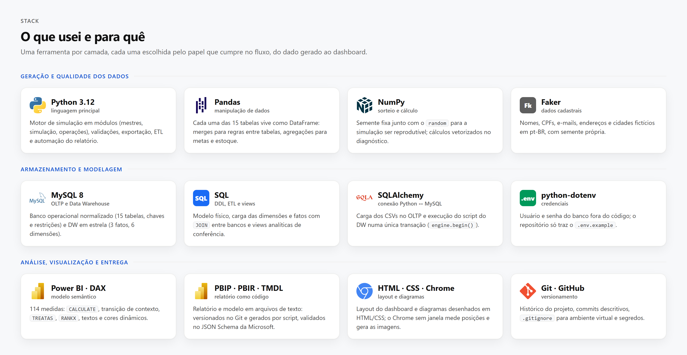
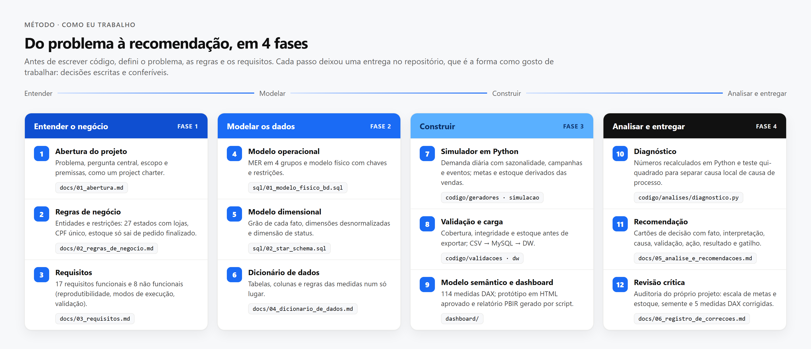
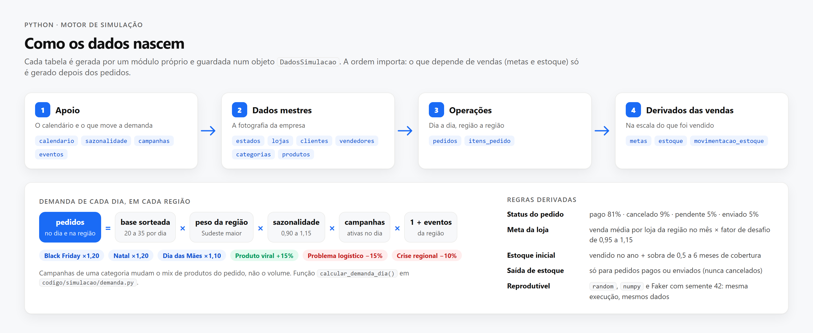
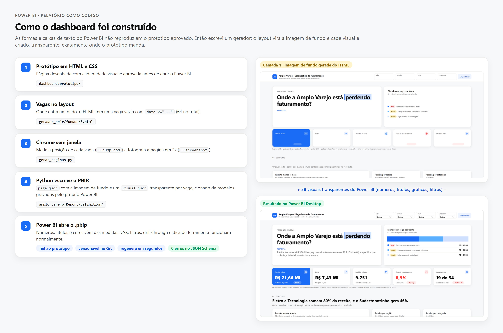

<p align="center">
  
  
  
  
  
  
</p>

<p align="center">
  <a href="https://matheusmendes.site/projetos/amplo-varejo"></a>
  <a href="https://matheusmendes.site/downloads/amplo-varejo-dashboard.zip"></a>
</p>

<p align="center">
  <a href="#-arquitetura">Arquitetura</a> ·
  <a href="#-python">Python</a> ·
  <a href="#-sql-e-modelagem">SQL e modelagem</a> ·
  <a href="#-power-bi-e-dax">Power BI e DAX</a> ·
  <a href="#-documentação">Documentação</a> ·
  <a href="#-decisões-técnicas">Decisões</a> ·
  <a href="#-como-executar">Executar</a>
</p>

## Sobre o projeto

Construí, sozinho e do zero, o ecossistema de dados de uma rede varejista fictícia: **as regras de negócio, o simulador que gera os dados, o banco operacional, o Data Warehouse, o modelo semântico e o dashboard**, e usei tudo isso para responder uma pergunta de negócio.

> **Pergunta:** onde a Amplo Varejo perde faturamento em 2025, quanto isso vale e por onde começar?
> **Resposta:** 3 frentes somam R$ 1,7 a 3,3 Mi recuperáveis; a maior é o cancelamento de pedidos (8,9% contra meta de 3%). [Análise completa](docs/05_analise_e_recomendacoes.md)

O foco deste README é **como foi feito**: as ferramentas, por que cada uma, e as decisões técnicas no caminho. A história do projeto, contada visualmente com o dashboard, está na [**apresentação no meu portfólio**](https://matheusmendes.site/projetos/amplo-varejo).



---

## 🧭 Como eu trabalhei

Antes de escrever código, escrevi o problema, as regras e os requisitos. Cada passo deixou uma entrega conferível no repositório.



---

## 🏗 Arquitetura

O pipeline roda inteiro com `python -m codigo.pipeline`. Se qualquer validação falha, ele para antes de exportar: nada inconsistente chega ao banco.


---

## 🐍 Python

**Por que Python:** a parte mais difícil do projeto era gerar dados que se comportam como uma empresa real (sazonalidade, campanhas, eventos regionais, relações entre tabelas). Isso pede lógica, não planilha. Python com Pandas deixou cada regra num módulo testável isoladamente.



<table>
<tr><th>Módulo</th><th>O que faz</th><th>Técnicas</th></tr>
<tr><td><code>geradores/</code></td><td>Dados mestres, pedidos, itens, estoque e movimentação</td><td>DataFrames, <code>merge</code>, amostragem ponderada, regras entre tabelas</td></tr>
<tr><td><code>simulacao/</code></td><td>Calendário, sazonalidade, campanhas, eventos, demanda e metas</td><td>Funções puras, filtros por intervalo de datas, multiplicadores</td></tr>
<tr><td><code>validacoes/</code></td><td>Cobertura, integridade referencial e estoque</td><td>Checagem com <code>isin</code>, saldo acumulado, pipeline interrompido em falha</td></tr>
<tr><td><code>exportadores/</code> · <code>dw/</code></td><td>CSV → MySQL e carga do Data Warehouse</td><td>SQLAlchemy, transação única (<code>engine.begin()</code>), credenciais em <code>.env</code></td></tr>
<tr><td><code>analises/</code></td><td>Recalcula todos os números da análise direto do DW</td><td>Agregações, teste qui-quadrado implementado sem SciPy</td></tr>
<tr><td><code>correcoes/</code></td><td>Corrige a escala de metas e estoque sem regenerar pedidos</td><td>Transformação determinística, idempotente (não roda duas vezes)</td></tr>
</table>

```python
# codigo/simulacao/demanda.py · pedidos de um dia numa região
demanda = random.randint(PEDIDOS_MINIMOS_DIA, PEDIDOS_MAXIMOS_DIA) * (pesos[regiao] / 100)
demanda *= sazonalidade["indice_vendas"]                     # 0,90 a 1,15 conforme o mês
for _, campanha in campanhas_gerais.iterrows():
    demanda *= campanha["multiplicador_vendas"]              # Black Friday ×1,20 ...
for _, evento in eventos_regiao.iterrows():
    demanda *= (1 + evento["impacto_vendas"])                # problema logístico −15% ...
```

**Reprodutibilidade:** `random`, `numpy` e Faker usam a mesma semente (42), e o projeto tem 3 modos de execução (desenvolvimento, teste e produção) que mudam só o volume.

---

## 🗄 SQL e modelagem

**Por que dois bancos:** o OLTP guarda a operação como ela acontece (normalizado, com restrições, bom para escrever). O Data Warehouse reorganiza os mesmos dados para leitura analítica (desnormalizado, em estrela, bom para filtrar e agregar). Separar os dois é como funciona numa empresa, e deixa o DAX muito mais simples.

**Banco operacional · 15 tabelas em 4 grupos, com chaves estrangeiras e restrições** ([`01_modelo_fisico_bd.sql`](sql/01_modelo_fisico_bd.sql))


**Data Warehouse · 3 fatos com grão definido e 6 dimensões** ([`02_star_schema.sql`](sql/02_star_schema.sql))


O ETL é SQL puro, executado pelo Python numa transação: lê do banco `amplo_varejo`, desnormaliza e calcula colunas derivadas ([`03_JOINS.sql`](sql/03_JOINS.sql)).

```sql
-- fato_vendas (grão: item de pedido) · custo e margem calculados na carga
INSERT INTO fato_vendas (sk_calendario, sk_cliente, sk_vendedor, sk_loja, sk_produto, sk_status, ...)
SELECT ped.id_calendario, ped.id_cliente, ped.id_vendedor, ped.id_loja, it.id_produto, dsp.sk_status, ...,
       ROUND(it.quantidade * prod.custo, 2)                AS custo_total,
       ROUND(it.sub_total - (it.quantidade * prod.custo), 2) AS margem
FROM amplo_varejo.itens_pedido it
JOIN amplo_varejo.pedidos  ped  ON ped.id_pedido   = it.id_pedido
JOIN amplo_varejo.produtos prod ON prod.id_produto = it.id_produto
JOIN dim_status_pedido     dsp  ON dsp.status      = ped.status;
```

Também há [views analíticas](sql/04_Views.sql) (KPIs gerais, receita mensal, meta × realizado) usadas para conferir os números do Power BI. *Os diagramas acima são gerados a partir do próprio SQL ([`gerar_diagramas.py`](assets/fontes/gerar_diagramas.py)), então nunca ficam desatualizados.*

---

## 📊 Power BI e DAX

**Modelo semântico.** 114 medidas organizadas em 9 pastas (base, metas, produtos, clientes, cancelamentos, diagnóstico, textos, formatação e rótulos), todas documentadas no [dicionário de dados](docs/04_dicionario_de_dados.md).

| Técnica | Onde usei | Exemplo |
|---|---|---|
| `CALCULATE` com filtro | Receita só de pedidos válidos | `CALCULATE(SUM(sub_total), sk_status <> 3)` |
| `TREATAS` | Meta (sem data) filtrada pelo mês do calendário, sem relacionamento físico | `TREATAS(VALUES('DIM Calendario'[mes]), 'FATO Metas'[mes])` |
| Transição de contexto | Excesso de estoque somado loja × produto | `SUMX(CROSSJOIN(lojas, produtos), …)` |
| `RANKX` e `TOPN` | Destacar os 2 maiores meses; título que cita a maior região | `RANKX(ALLSELECTED(…), [Receita_Total])` |
| Medidas de texto | Títulos que mudam com o filtro | *"A taxa de cancelamento é 8,9%, 3,0× a meta…"* |
| Formatação condicional | Cor da barra vinda de uma medida | vermelho se a loja está abaixo da meta |

```dax
Meta_Faturamento =
CALCULATE ( SUM ( 'FATO Metas'[meta_faturamento] ),
            TREATAS ( VALUES ( 'DIM Calendario'[mes] ), 'FATO Metas'[mes] ) )

Taxa Cancelamento = DIVIDE ( [Pedidos Cancelados], [Pedidos Totais], 0 )
```

**Relatório como código.** O projeto está em formato **PBIP** (relatório PBIR em JSON e modelo TMDL em texto), então tudo é versionado no Git. Como as formas nativas do Power BI não reproduziam o protótipo aprovado, escrevi um gerador em Python que transforma o layout HTML no relatório:



**Resultado.** Uma página de diagnóstico em rolagem, uma página de detalhe por loja (drill-through) e uma dica de ferramenta por região.

<table>
<tr>
<td width="50%"><br><sub>Diagnóstico: pergunta, resposta, dinheiro em jogo e KPIs dinâmicos.</sub></td>
<td width="50%"><br><sub>Drill-through: a causa dominante de cada loja calculada em DAX.</sub></td>
</tr>
<tr>
<td width="50%"><br><sub>Achado + cartão de decisão (fato, interpretação, ação, causas, resultado).</sub></td>
<td width="50%"><br><sub>Fechamento: priorização, decisões pedidas e plano de ação.</sub></td>
</tr>
</table>

📄 [Página inteira](dashboard/prints/00_diagnostico_completo.png) · [Todos os prints](dashboard/prints/) · [Detalhes do gerador](dashboard/README.md)

---

## 📚 Documentação

Escrevi a documentação como faria num projeto de empresa: alguém de fora consegue entender, conferir e continuar.

| Documento | Conteúdo |
|---|---|
| [01 · Abertura](docs/01_abertura.md) | Problema, pergunta central, escopo, premissas e limitações (project charter) |
| [02 · Regras de negócio](docs/02_regras_de_negocio.md) | Entidades e restrições que o simulador respeita |
| [03 · Requisitos](docs/03_requisitos.md) | 17 requisitos funcionais e 8 não funcionais |
| [04 · Dicionário de dados](docs/04_dicionario_de_dados.md) | Tabelas do DW e as 114 medidas DAX, geradas a partir do modelo |
| [05 · Análise e recomendações](docs/05_analise_e_recomendacoes.md) | Cartões de decisão com causas, validação, ação e acompanhamento |
| [06 · Registro de correções](docs/06_registro_de_correcoes.md) | O que estava errado no próprio projeto, o que mudou e como reproduzir |

---

## 🧠 Decisões técnicas

| Decisão | Por quê |
|---|---|
| **Dados sintéticos, gerados por regras** | Controlar o cenário e praticar o que vem antes da análise: modelar, gerar, validar e carregar. |
| **Validar antes de exportar** | Um erro barrado no Python não vira um número errado no dashboard. |
| **Metas e estoque derivados das vendas** | Na primeira versão a meta era ~20× a venda real. Derivar das vendas mantém a escala em qualquer modo de execução. |
| **Star Schema com dimensões desnormalizadas** | Menos relacionamentos no Power BI e medidas DAX mais simples e rápidas. |
| **`TREATAS` em vez de relacionamento** | `fato_metas` tem grão loja × mês, sem data: um relacionamento com o calendário seria ambíguo. |
| **Números conferidos fora do Power BI** | [`diagnostico.py`](codigo/analises/diagnostico.py) recalcula tudo direto do DW; foi assim que encontrei 5 medidas DAX erradas. |
| **Teste estatístico antes de recomendar** | O qui-quadrado mostrou que o cancelamento não varia entre regiões, lojas, meses e categorias: o problema é de processo, não de um lugar. Isso mudou a recomendação. |
| **Relatório em PBIP gerado por script** | Fiel ao protótipo, versionável e regenerável em segundos. |
| **Credenciais fora do código** | `.env` no `.gitignore`, só o `.env.example` vai para o repositório. |

---

## ▶ Como executar

**Só ver o dashboard:** baixe o [ZIP do dashboard](https://matheusmendes.site/downloads/amplo-varejo-dashboard.zip) (3 MB), extraia a pasta, instale o [Power BI Desktop](https://www.microsoft.com/pt-br/power-platform/products/power-bi/desktop) (gratuito) e abra `amplo_varejo.pbip`. Os dados vêm junto; não precisa de banco.

**Rodar o projeto inteiro:**

```bash
git clone https://github.com/matheusmendesgestaopessoal/amplo-varejo-simulador.git
cd amplo-varejo-simulador
python -m venv venv && venv\Scripts\activate
pip install -r requirements.txt
copy .env.example .env            # preencha com os dados do seu MySQL
# crie os bancos com sql/01_modelo_fisico_bd.sql e sql/02_star_schema.sql

python -m codigo.pipeline              # gera, valida, exporta, carrega OLTP e DW
python -m codigo.analises.diagnostico  # recalcula os números da análise
```

<details>
<summary><b>Estrutura do repositório</b></summary>

```
amplo-varejo-simulador/
├── codigo/
│   ├── analises/          # diagnostico.py: recalcula os números da análise
│   ├── configuracoes/     # parâmetros da simulação e conexão com o banco
│   ├── correcoes/         # correção de escala de metas e estoque
│   ├── dw/                # carga do Data Warehouse
│   ├── exportadores/      # CSV e MySQL
│   ├── geradores/         # dados mestres, operações e motor da simulação
│   ├── simulacao/         # calendário, sazonalidade, campanhas, eventos, demanda, metas
│   ├── utilitarios/       # Faker, catálogo de produtos, regiões
│   ├── validacoes/        # cobertura, integridade e estoque
│   └── pipeline.py
├── dados/brutos_csv/      # dados publicados (15 tabelas)
├── dashboard/
│   ├── amplo_varejo.pbip  # Power BI Project: relatório (PBIR) + modelo (TMDL) + dados
│   ├── gerador_pbir/      # gera o relatório a partir do layout em HTML
│   ├── prints/            # imagens tiradas do Power BI
│   └── prototipo/         # protótipo aprovado antes do Power BI
├── docs/                  # 6 documentos do projeto
├── sql/                   # modelo físico, star schema, carga do DW e views
├── assets/                # imagens do README (fontes/ gera todas a partir de HTML e do SQL)
├── .env.example
└── requirements.txt
```
</details>

---

## Próximos passos

- Registrar o motivo do cancelamento na simulação, para testar causas e não só taxas.
- Gerar mais de um ano de dados e analisar tendência.
- Migrar o banco para PostgreSQL e adicionar testes automatizados (pytest) às validações.

---

## Autor

**Matheus Mendes** · Analista de Dados · SQL · Python · Power BI

Passei mais de três anos na operação de empresas de engenharia e manutenção (programação, medição e faturamento de cerca de 3 mil ordens de serviço por mês) e foi digitalizando processos que encontrei os dados. Hoje curso Análise e Desenvolvimento de Sistemas e trabalho com análise de dados de ponta a ponta, do banco ao dashboard.

[](https://matheusmendes.site/)
[](https://www.linkedin.com/in/matheusmendes-dados)
[](https://github.com/matheusmendesgestaopessoal)
[](mailto:matheus.mendesgestao@gmail.com)
